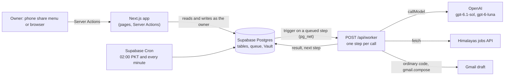

# Shortlist

A personal job-search system for one owner. Every night it finds jobs, keeps the ones that fit the owner's profile, ranks them and writes a short note for each. During the day it turns a LinkedIn hiring post shared from the phone into a Gmail draft with the right CV attached, and answers application forms from screenshots. **Nothing is sent or submitted.** The system prepares; the owner reviews and sends.

It is a portfolio project showing workflow design with LLMs, evaluation, cost control and security.

- What is being built, and how success is judged: [docs/REQUIREMENTS.md](docs/REQUIREMENTS.md)
- How it is built, sprint by sprint: [docs/PLAN.md](docs/PLAN.md)
- Rules for contributors and coding agents: [AGENTS.md](AGENTS.md)

## What it does

| Path | Trigger | Result |
|---|---|---|
| **Capture** | The owner shares a post or screenshot from Android, or pastes it | Role, company and contact extracted; an email written in the owner's voice, fact-checked against the profile, and saved as a Gmail draft with the chosen CV. Under a minute |
| **Forms** | The owner adds screenshots of a form and its job post | Every question listed, then answered from the profile and answer bank, with copy buttons. Anything the profile cannot support is marked for the owner |
| **Discovery** | Every night at 02:00 Pakistan time | New jobs fetched from Himalayas, filtered in plain code, scored by a model, the best kept, and each given a chosen CV and a tailored note |

The review app ties them together: a daily list with one-tap statuses (sent, skipped, replied, interview), a Jobs page to mark Apply or Skip, Settings for the model per step and the monthly cap, and Reports for spending and reply rates.

## Architecture



**A workflow, not an agent.** Code decides every step; models are called along the way and never get open-ended control. Every piece of work is a chain of short steps on a Postgres queue (Supabase Queues). Queuing a step makes the database call the worker at once. The worker runs one step, which makes at most one model call, saves its result and queues the next step. A failed step is retried twice, then shown in the app with Try again.

**Why short steps.** No call runs past 60 seconds and no work continues after a response, so the host only serves pages and answers short HTTPS calls. The schedule, queue and triggers all live in Supabase, and nothing host-specific is used, so moving from Vercel to AWS Amplify is a configuration change.

**The write-check-revise loop** is a LangGraph graph whose state is saved in Postgres. Each queued step advances it by one stage: write, check, revise if needed. Before the model's check, plain code confirms that every number and technology in the draft appears in the profile, and that the draft is within its word limit.

**Every model call goes through one function** (`callModel`). It reads the step's provider, model and reasoning effort from the database, checks the answer against a Zod schema, and records tokens, cost and time, also when the call fails. Changing a step's model is a setting in the app, not a code change.

## Safety rules, enforced in code

| Rule | How it is enforced |
|---|---|
| Nothing is sent | No code calls `messages.send`, `drafts.send`, `sendMail` or `createTransport`; a rule test fails the build if any does. The Gmail token is refused if it has any permission other than `gmail.compose` |
| Only true claims | Drafts and answers come only from the stored profile and answer bank; a code check and a model check both run before a draft is saved |
| Job posts are untrusted | The model has no access to Gmail or to any action. A draft's recipient always comes from the capture. Tests with a fake model that obeys hidden instructions in posts, forms and listings show they cause no action |
| Only permitted sources | Automated reading only where the source's terms allow it; never LinkedIn, Wellfound or sites behind a login |
| Spending cap | Once the month's model spending reaches the cap, the nightly run stops; captures and forms still run |
| Private by default | No secrets or personal data in the repository. CI scans the full history with gitleaks and checks every file against the owner's details |

## Model results

The owner's quality checks (REQUIREMENTS.md section 7) run with `pnpm eval <check> --models <model>@<effort>,...` over private cases. Results: [frontend/evals/results/](frontend/evals/results/).

| Check | Bar | Result on `gpt-6.1-sol` (low) |
|---|---|---|
| E1: extraction from pasted posts | 100% | 7/7 |
| E1: extraction from screenshots | 95% | 8/8 |
| E4: right recipient, role and CV on every draft | 100% | 5/5 |

Two checks depend on real use and are in progress: E2 (at least 70% of each night's list worth applying to, judged on 200 Apply or Skip marks) and E3 (no unsupported claims in 50 drafts, checked by hand).

| Step | Model | Effort | Why |
|---|---|---|---|
| Extraction, email writing, form reading and answering | `gpt-6.1-sol` | low | Passes E1 and E4; low effort keeps a capture under a minute |
| Checking emails and form answers | `gpt-6.1-sol` | medium | The check guards truthfulness, so it gets more effort than the writer |
| Writing and checking nightly notes | `gpt-6.1-sol` | medium | Overnight, so time is no constraint |
| Scoring listings | `gpt-6-luna` | medium | One call per listing every night; lowest cost per task among the lower-priced models |

These are the starting models from PLAN.md section 4, kept as final for now (24 October 2026). Cheaper challengers can be compared with the same harness once their provider is added.

## Cost

From the `model_calls` table, which records every call:

| Measure | Cost |
|---|---|
| Scoring one listing | $0.0005 |
| Extracting a captured post | $0.005 |
| Writing and checking one email | about $0.04 |
| One nightly run (fetch, score, notes) | $0.17 to $0.40 |
| Everything so far, 15 to 23 October 2026, including building and testing (414 calls) | $4.69 |

At the current rate the nightly run costs about $5 to $12 a month, well under the $35 to $50 first estimated. Hosting is free: Vercel's and Supabase's free plans.

## Prior art

Two large open-source projects do part of what Shortlist does. Research on 14 October 2026 is in [docs/research/](docs/research/).

| | [career-ops](https://github.com/career-ops-hq/career-ops) | [ai-job-search](https://github.com/MadsLorentzen/ai-job-search) | Shortlist |
|---|---|---|---|
| Runs | Locally, inside a coding assistant | Locally, inside a coding assistant | A hosted web app, installable on Android so it appears in the share menu |
| Data | Files | Files | Postgres, with duplicate keys so a job gets one application |
| Work | Interactive sessions | Interactive sessions | Short steps on a queue, run nightly and on demand |
| Output | Email text to paste and CV PDFs; its web app pre-fills forms in a browser, never submitting | Files | Gmail drafts (draft permission only) and answers to copy; nothing is submitted |
| Quality | A code fact check on generated PDFs; evals for scoring only | A reviewer prompt | Code and model checks on every draft, and an evaluation harness with pass bars |
| Spending | No cap | No cap | A monthly cap that stops the nightly run |

Neither was forked, as both are built around a local coding assistant and files. These parts were reused, translated into TypeScript, and credited in [THIRD_PARTY_NOTICES.md](THIRD_PARTY_NOTICES.md): ai-job-search's duplicate key, banned phrases, reviewer's grounding audit and scoring rubric; and career-ops's idea of checking every number and tool in a draft against the profile.

## Stack

TypeScript throughout. Next.js 16 and React 19, Tailwind CSS, Supabase (Postgres, Auth, Storage, Queues, Cron, Vault), LangGraph and LangChain's model classes, Zod, the Gmail API. Tests: Vitest, React Testing Library, pgTAP and Playwright. Hosted on Vercel's free plan; CI on GitHub Actions.

## Layout

- `frontend/`: the Next.js app. `src/features/` holds one folder per feature with its Server Actions, reads, queue steps and screens; `src/server/` holds shared server code (auth, queue, models, Gmail).
- `frontend/evals/`: the evaluation harness and results tables (cases are private).
- `supabase/`: database migrations, database tests and configuration.
- `docs/`: requirements, plan and research.

## Development

Requires Node 24, pnpm and a Supabase project.

```bash
cd frontend
pnpm install
pnpm dev               # the app
pnpm test              # unit, component and rule tests
pnpm test:integration  # server code against Supabase, with a fake model
pnpm test:db           # pgTAP: tables, access rules, functions
pnpm test:e2e          # Playwright, desktop and Android sizes
```

Model calls are never made in tests. `pnpm eval` uses real models and costs money.
